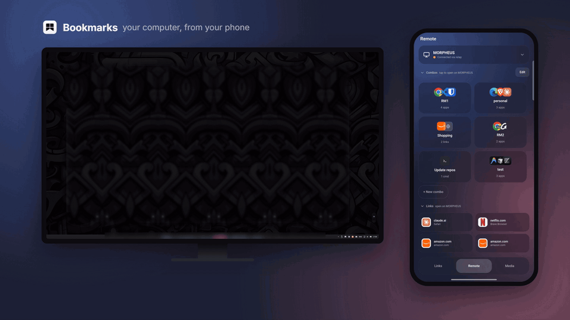

# Bookmarks

Your links and app "combos" on every computer, with your phone as the remote.



- **Links**: save bookmarks once and they show up on all your paired devices.
- **Combos**: a named group of apps, links and terminal commands that open together, and close together. "Work" can be Slack + VS Code + a Jira tab + `npm run dev`.
- **Phone remote**: open or close combos on your computer, open a link there, or bring an open app to the front, from your Android phone.
- **Media**: see what's playing on the computer, then play, pause, skip, change the volume or mute the microphone from your phone.
- **Quick access**: a small widget from the tray icon, a floating pill on the screen edge, or a keyboard shortcut. Ctrl+Alt+1–9 (⌥⌘1–9 on a Mac) opens combo 1–9.

Devices talk to each other directly and end-to-end encrypted. There's no account and no server that stores your data.

## Download

Get the files from the **[latest release](../../releases/latest)**.

| Device | File | Updates |
| --- | --- | --- |
| Windows 10 / 11 | `Bookmarks_<version>_x64-setup.exe` (or the `.msi`) | Automatic, at launch |
| Mac (Apple silicon) | `Bookmarks_<version>_aarch64.dmg` | Automatic, at launch |
| Android 7+ (64-bit) | `Bookmarks_<version>_android-arm64.apk` | By hand: install the new `.apk` over the old one |

The other files (`.sig`, `.app.tar.gz`, `latest.json`) are for the desktop app's self-update. You don't need them.

## Install

The app isn't signed with a paid developer certificate yet, so each system warns you the first time.

**Windows**: run the setup. If SmartScreen says "Windows protected your PC", click **More info → Run anyway**.

**Mac**: open the `.dmg` and drag Bookmarks to Applications. If macOS says the app "can't be opened" or "is damaged", go to **System Settings → Privacy & Security** and click **Open Anyway**, or run once in Terminal:

```bash
xattr -dr com.apple.quarantine /Applications/Bookmarks.app
```

**Android**: download the `.apk` on the phone and open it. Allow your browser or file manager to install apps when asked. To update, install the newer `.apk` the same way: your links and pairings stay.

## Pair your devices

1. On a computer: open the widget → **Devices** → **Pair**. It shows a QR code and a pairing code, valid once for 10 minutes.
2. On the phone: tap the computer bar at the top → **Scan QR**. Between two computers: **Devices** → **Join** on the other one, and paste the code.

Paired devices sync links and combos and can act as a remote for each other. Only paired devices can connect.

## Good to know

- **Settings are per computer**: the shortcut, the pill, open at login.
- **Terminal commands never leave the computer they were added on.** They aren't synced. Your phone can start a combo's commands but never sees, adds or changes them.
- **Apps are matched by name across Windows and Mac**: "Visual Studio Code" picked on one runs "Visual Studio Code" on the other. Microsoft Store apps can't be matched this way.
- **Updates**: the desktop app checks for a new version when it starts, installs it quietly and restarts.

## Release notes

See each [release](../../releases) for what changed.
